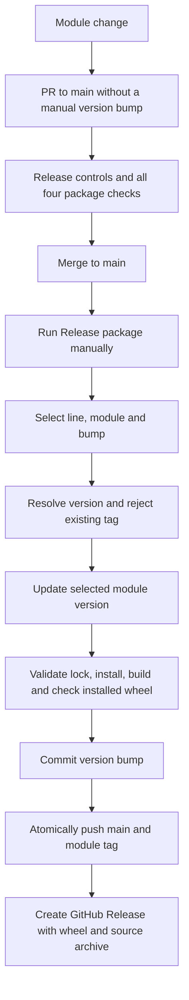

# HSE Wagtail Packages — release demo

A standalone monorepo demonstrating the release pattern used by
`hse-wagtail-packages`, extended to two compatibility lines on **one `main`
branch**. There is no demo website or production HSE code.

See [VALIDATION.md](VALIDATION.md) for the local checks and exact resolved stacks.

## Structure

```text
.github/workflows/
  ci.yml
  release-package.yml
scripts/
  release.py
  check_package.py
tests/
  test_release.py
wagtail6/packages/
  component-lib/
    pyproject.toml
    poetry.lock
    README.md
    src/hse_demo_components/
  important-redirects/
    pyproject.toml
    poetry.lock
    README.md
    src/hse_demo_redirects/
wagtail74/packages/
  component-lib/            # same layout; independent version and lock
  important-redirects/      # same layout; independent version and lock
```

| Line | Wagtail | Django | Python used by CI |
| --- | --- | --- | --- |
| `wagtail6` | `>=6.4,<6.5` | `>=4.2.26,<4.3` | 3.12 |
| `wagtail74` | `>=7.4,<7.5` | `>=5.2.19,<5.3` | 3.12 |

Each module declares Python `>=3.12,<3.14`. The lockfiles record the exact
resolved dependencies; the CI checks the combinations above on Python 3.12.
The legacy line exists to demonstrate the requested release structure; it is
not a declaration that the legacy stack is suitable for a new production site.

| Release identifier | Distribution | Import |
| --- | --- | --- |
| `component_lib` | `hse-demo-component-lib` | `hse_demo_components` |
| `important_redirects` | `hse-demo-important-redirects` | `hse_demo_redirects` |

The distributions/imports deliberately use demo names. The two lines are
alternatives for a consumer, not packages to install together in one environment.

## Independent versions and tags

The source of truth is the `version` field in **each module's** `pyproject.toml`.
Versions do not represent Wagtail versions and do not advance together.

```text
<line>/<package_name>-v<version>

wagtail6/component_lib-v1.0.0
wagtail6/important_redirects-v1.0.0
wagtail74/component_lib-v1.0.0
wagtail74/important_redirects-v1.0.0
```

For example, `patch` on `wagtail6/component_lib` changes its version from
`1.0.0` to `1.0.1`. The other three module versions stay unchanged. A later
`minor` on `wagtail74/component_lib` changes that module to `1.1.0`.

Only modules receive versions, tags and releases. There is no project-wide
version, combined project release, root Poetry package or Git submodule.

## Release flow



Merging code does **not** automatically release it. Open **Actions → Release
package → Run workflow**, choose branch `main`, then select:

| Input | Options |
| --- | --- |
| `line` | `wagtail6`, `wagtail74` |
| `package` | `component_lib`, `important_redirects` |
| `bump` | `current`, `patch`, `minor`, `major`, `custom` |
| `custom_version` | Required only for `custom`, e.g. `2.3.1` |

`current` creates the first tag/release for the existing version without a
version-bump commit. `custom` must be a final `X.Y.Z` version greater than the
current version. Previews and prereleases are outside this demo.

Releases run one at a time because they all write `main`. A concurrent change
to `main` causes the atomic push to fail; the workflow never force-pushes or
moves an existing tag. Notes only include commits/files from the selected module
and compare against its previous tag **in the same compatibility line**.

The release job builds and publishes in one workflow. A tag pushed using
`GITHUB_TOKEN` normally does not trigger a second workflow. See
[GitHub's workflow triggering rules](https://docs.github.com/en/actions/how-tos/write-workflows/choose-when-workflows-run/trigger-a-workflow).

If the tag push succeeds but GitHub Release creation fails, inspect the failed
run and create the missing Release against that existing tag, attaching the
matching build artifacts. Do not rerun with a new version or move the tag just
to recover the Release entry.

## Running locally

Use Python 3.12 and Poetry **2.2.1**, the same Poetry version pinned in CI.

```bash
python3.12 -m venv /tmp/hse-demo-tools
/tmp/hse-demo-tools/bin/python -m pip install poetry==2.2.1
export PATH="/tmp/hse-demo-tools/bin:$PATH"
export POETRY_VIRTUALENVS_IN_PROJECT=true

python -m unittest discover -s tests -v
python scripts/check_package.py --line wagtail6 --package component_lib
python scripts/check_package.py --line wagtail6 --package important_redirects
python scripts/check_package.py --line wagtail74 --package component_lib
python scripts/check_package.py --line wagtail74 --package important_redirects
```

Each package check validates its lock, synchronises its environment, runs
`pip check`, builds wheel/sdist, installs the wheel and checks its imports and
the actual Django/Wagtail versions. It restores the editable installation at
the end. Release-control tests only create tags/commits in disposable local
repositories; they never publish anything.

Inspect a proposed release locally without changing a version or creating a tag:

```bash
python scripts/release.py plan \
  --line wagtail6 --package component_lib --bump patch
```

When changing dependencies, run `poetry lock` inside the selected module and
commit both its `pyproject.toml` and `poetry.lock`. Do not manually bump an
existing module's version in a feature PR. A package's own lock makes its CI
reproducible; consumers still need their own lockfiles.

## Installing a released demo module

Repository: `dept-alex-costa/hse-wagtail-packages-demo`. Once the tag in the
example has been released:

```toml
[tool.poetry.dependencies]
hse-demo-component-lib = { git = "https://github.com/dept-alex-costa/hse-wagtail-packages-demo.git", tag = "wagtail6/component_lib-v1.0.0", subdirectory = "wagtail6/packages/component-lib" }
```

For the other line, select its tag **and** its matching subdirectory:

```toml
[tool.poetry.dependencies]
hse-demo-component-lib = { git = "https://github.com/dept-alex-costa/hse-wagtail-packages-demo.git", tag = "wagtail74/component_lib-v1.0.0", subdirectory = "wagtail74/packages/component-lib" }
```

These are alternative examples. Then run `poetry lock` and `poetry install` in
the consuming project and commit its lock. Authentication for a private Git
repository must be provided separately; do not put credentials in these files.

## GitHub setup

This directory is a standalone repository scaffold. To run its workflows, its
contents must be at the **root of its own GitHub repository**, with `main` as
the default branch. Workflows inside a subdirectory of another repository do
not activate.

The release job uses the repository's `GITHUB_TOKEN` with `contents: write`;
it does not need a PAT or publish to PyPI. Repository/organisation settings and
rulesets must permit that workflow to push its version-bump commit and tags.
If direct pushes to `main` are prohibited, the release process needs to be
adapted to a version-bump PR; do not disable the ruleset to make the demo run.

To require CI before merging, configure the `Release controls` check and all
four `Package checks (...)` checks as required checks for `main`.

## Reference

- Original pattern: `HSEIreland/hse-wagtail-packages`, manual **Release package** workflow.
- [Poetry lockfile guidance](https://python-poetry.org/docs/basic-usage/#committing-your-poetrylock-file-to-version-control).
- [Wagtail compatibility matrix](https://docs.wagtail.org/en/stable/releases/upgrading.html#compatible-django-python-versions).

